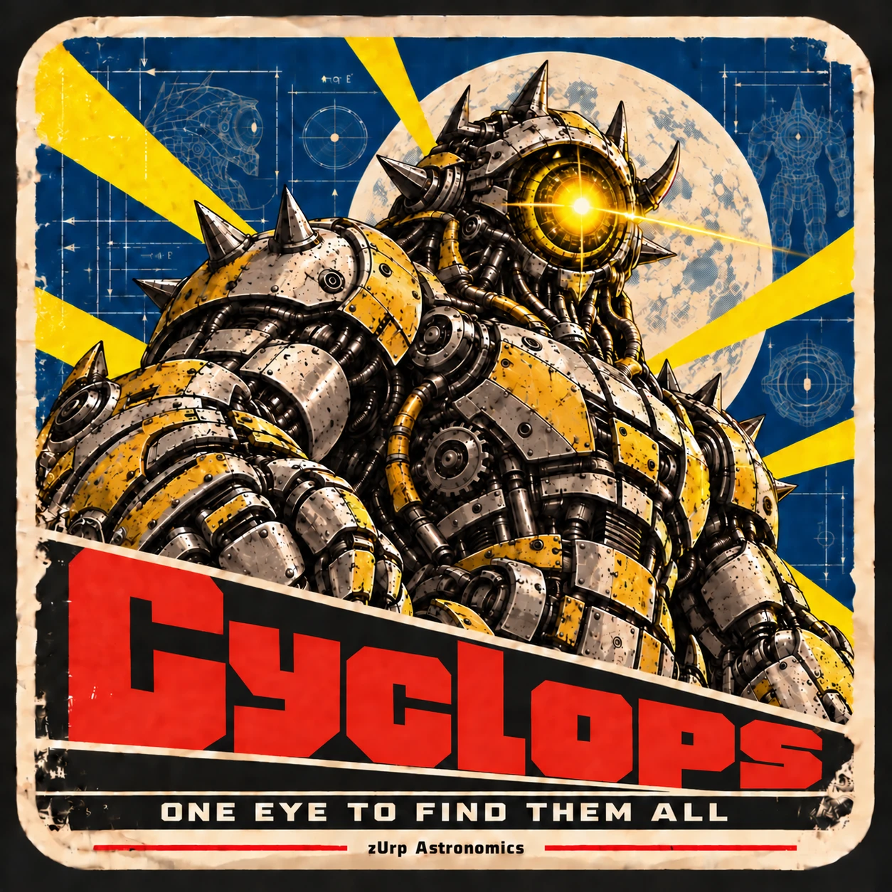

<!-- zurp-readme-header:begin — paste this block once, never again: the poster and the badges update themselves at each build of the site — do not edit it -->

<!-- zurp-readme-header:end -->

<h1 align="center">Cyclops</h1>

<strong><em>One eye to find them all</em></strong>

  <a href="https://zurp-astronomics.github.io/cyclops/">Website</a> ·
  <a href="../../releases">Releases</a> ·
  <a href="https://github.com/zUrp-Astronomics">zUrp Astronomics</a>

---

## 🔭 Design phase — nothing to build yet 🔭

**This product is being designed.** No hardware, no firmware, no files to build from yet. 
👀 Watch the repository to follow it from the first sketch.

---

## Why Cyclops?

A visual telescope that always knows where it points — **no imaging camera, no laptop in the field**.
Cyclops is an autonomous astrometry finder: a Raspberry Pi Zero 2 W and an HQ camera behind a
telephoto lens, riding on the tube and plate-solving the sky to know exactly where your telescope is
looking. It talks to the mount and to your phone. One eye on the sky, and the hunt is over.

## At a glance

| | |
|---|---|
| Job | plate-solving finder for visual telescopes |
| Brain | Raspberry Pi Zero 2 W |
| Eye | Raspberry Pi HQ camera behind a telephoto lens |
| Talks to | the mount, and your phone |

## Credits

Based on the diofinder project.

## Repository layout

| Folder | Contents |
|---|---|
| [`9_Assets/`](9_Assets/) | the showcase: product sheet, poster and README images |

## License

- **Hardware design** — boards, mechanics and 3D models: [Open Community License v1.1](LICENSE-HARDWARE).
- **Everything else** — firmware, software, documentation and images: [GNU GPL v3.0](LICENSE).

---

<a href="https://zurp-astronomics.github.io/">zUrp Astronomics</a> — a subsidiary of zUrp Industries. Because buying is cheating.

